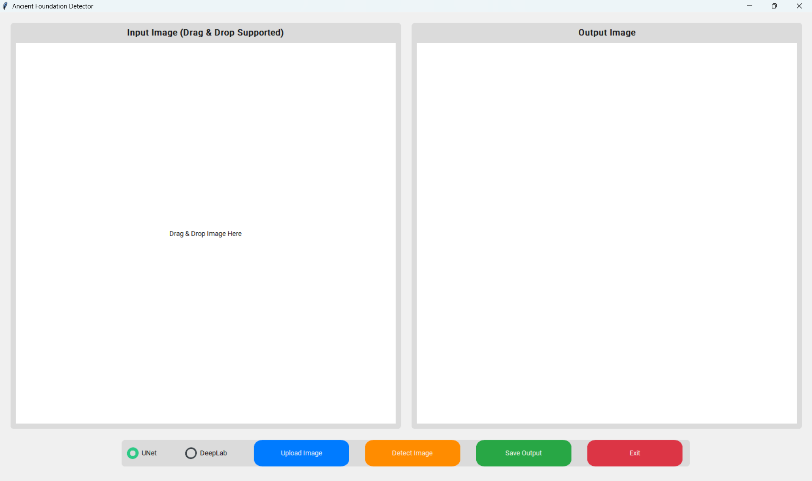
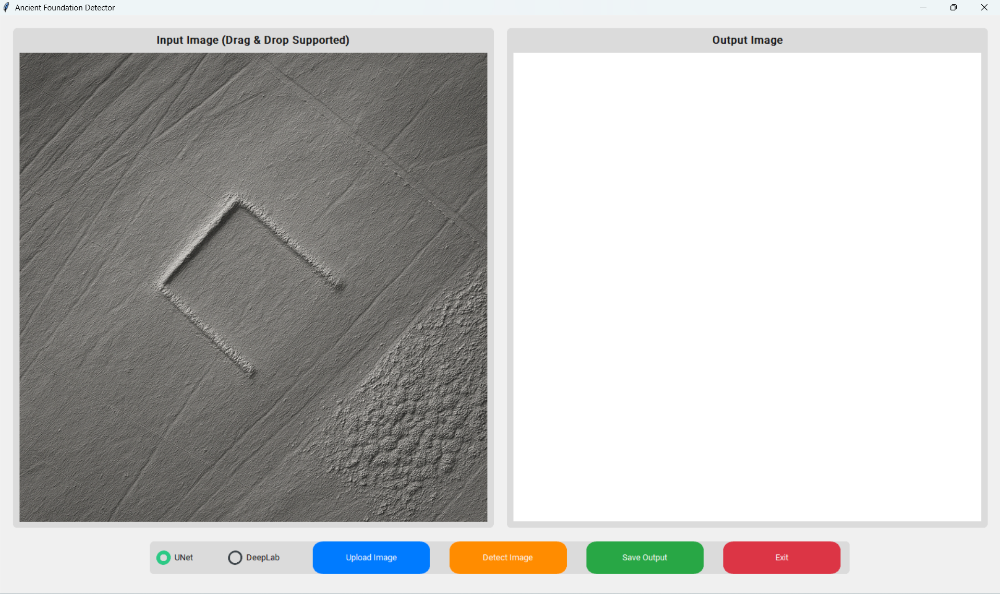
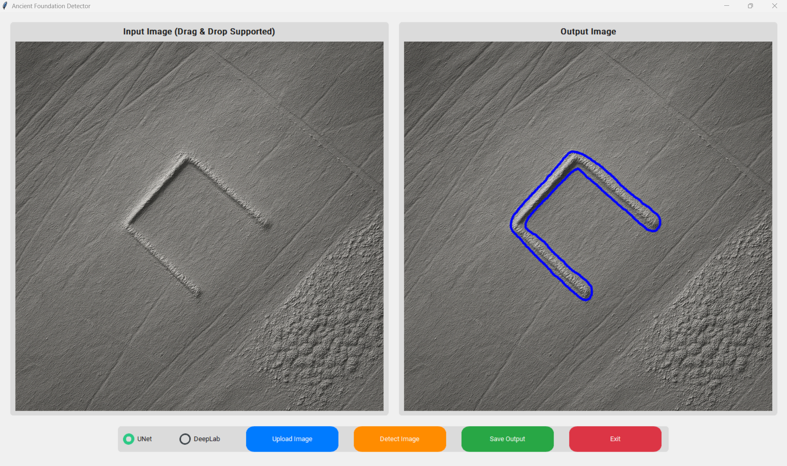
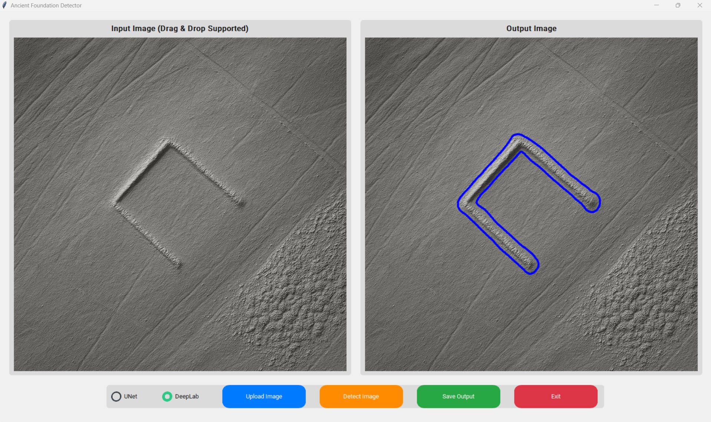
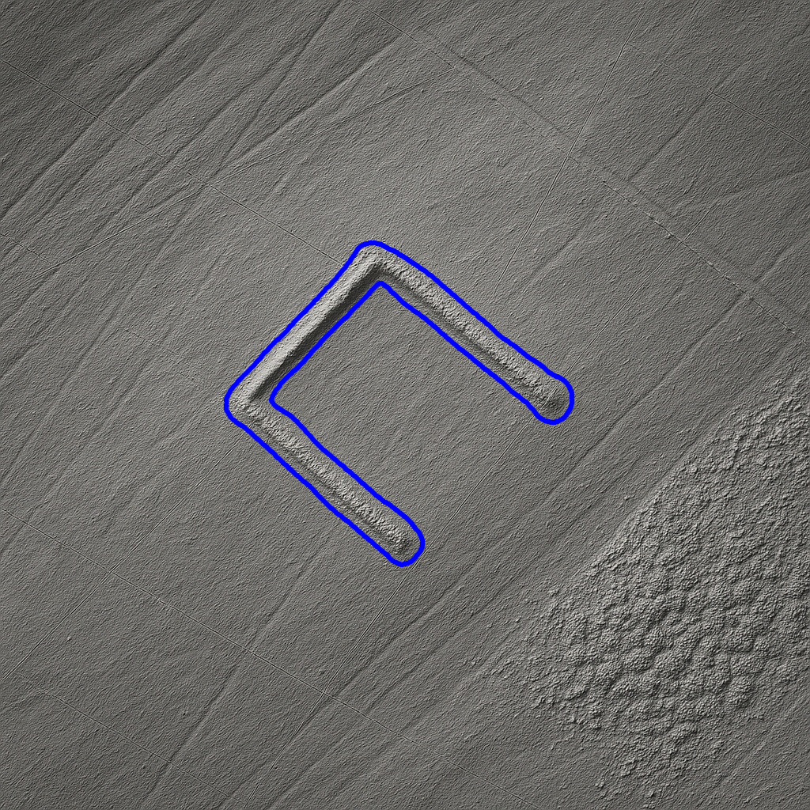

# Ancient Foundation Detection Using Machine Learning

## 📊 Project Overview

I developed a Python desktop application that uses deep learning and computer vision to identify potential ancient foundation patterns in synthetic LiDAR-style terrain images.

The objective was to explore how automated image segmentation could assist archaeological image analysis by highlighting geometric features that may indicate human-made structures. Users can upload an image, select one of two trained models, and view or save the highlighted output.

**This is a Master's research prototype, not a verified archaeological site identification tool.**

## 🛠️ Tools & Technologies

- **Python** – Application development and model inference
- **PyTorch & Torchvision** – Deep learning and DeepLabV3 implementation
- **Segmentation Models PyTorch** – U-Net implementation
- **OpenCV, NumPy, SciPy & Pillow** – Image processing, contour extraction and smoothing
- **CustomTkinter & TkinterDnD2** – Desktop GUI and drag-and-drop support
- **Google Colab** – Model training
- **Roboflow** – Image annotation and dataset export in COCO format
- **Adobe Photoshop** – Dataset image editing

## 📁 Dataset Information

I prepared a custom dataset using synthetic LiDAR-style images, with visual references taken from LiDAR map imagery of England and Wales.

- Created **75 synthetic images**, then expanded the collection to **100 images** using image editing.
- Annotated geometric features in Roboflow using three labels: **Box, Circle and Line**.
- Expanded the annotated dataset to **300 images**.
- Exported annotations in **COCO format**.
- Used an **80% training / 20% validation** split for model development.

The application performs **binary segmentation** of potential foundation features rather than separately classifying the three annotation labels.

### 📥 Dataset Access

The custom dataset developed for this Master's research project is publicly available on Kaggle.

**Dataset:** [Ancient Foundations Detection Dataset](https://www.kaggle.com/datasets/alirazasadaq/ancient-foundations-detection-dataset)

**Platform:** Kaggle

**Created by:** Ali Raza

## 🧠 Deep Learning Models

**1. U-Net (ResNet34 Encoder)**

A semantic segmentation model used to identify potential foundation regions at the pixel level.

**2. DeepLabV3 (ResNet50 Backbone)**

A semantic segmentation model used to detect potential archaeological features through spatial context and pixel-level predictions.

Both models were trained using Google Colab and integrated into the desktop application for model selection and visual comparison.

## 📈 Model Evaluation

| Model | Reported Accuracy |
|---|---|
| U-Net (ResNet34) | 82% |
| DeepLabV3 (ResNet50) | 85% |

These figures are reported in the Master's evaluation document for experiments on **synthetic imagery**. They should not be interpreted as accuracy on independently verified real-world archaeological sites. The DeepLab training log also records validation Intersection over Union (IoU) measurements.

## 🖥️ Application Features

**1. Image Upload and Drag & Drop**

Upload a `.jpg`, `.jpeg` or `.png` image through the interface.

**2. Model Selection**

Choose between U-Net and DeepLabV3 using radio buttons.

**3. Automated Detection**

Run image segmentation to identify potential foundation-like features. Image-processing operations reduce noise, extract contours and smooth the highlighted boundaries.

**4. Side-by-Side Visualisation**

Compare the original image with the detected output in the same window.

**5. Save Output**

Save the processed image for further review.

## 🔍 Detection Results

The sample results show blue contours highlighting geometric features in LiDAR-style terrain imagery. The screenshots illustrate the interface and the output of both trained models.

### Application Dashboard

### Input Image

### U-Net Detection

### DeepLabV3 Detection

### Example Detection Output

## 🧹 Data Preparation and Processing

- Created and edited synthetic LiDAR-style imagery.
- Annotated geometric features and prepared COCO-format data.
- Prepared training and validation datasets.
- Trained two image segmentation architectures.
- Converted model predictions into binary masks.
- Applied morphological filtering and contour smoothing to produce visual overlays.

## 🎯 Skills Demonstrated

- Python Programming
- Deep Learning and Computer Vision
- Image Segmentation (U-Net and DeepLabV3)
- Custom Dataset Preparation and Annotation
- Model Training and Validation
- Image Preprocessing and Post-processing
- Model Integration and Inference
- Desktop GUI Development
- Research Evaluation and Technical Documentation

## 📂 Project Files

| File / Folder | Description |
|---|---|
| `gui.py` | Desktop application and user interface |
| `model_unet.py` | U-Net model loading |
| `model_deeplab.py` | DeepLabV3 model loading |
| `scripts/detect.py` | Segmentation inference and contour visualisation |
| `UNet_Training.ipynb` | U-Net training notebook |
| `DeepLab_Training.ipynb` | DeepLab training notebook |
| `requirements.txt` | Python dependencies |
| `screenshots/` | Dashboard and detection screenshots |
| `README.md` | Project documentation |

**Model weights:** Running the application also requires trained `.pth` files in the `models/` folder (`ancient_foundation_unet.pth` and `ancient_foundation_deeplab.pth`). These files are not included among the screenshots and documentation provided here.

## ▶️ Running the Application

1. Clone the repository and open the project folder.
2. Create and activate a Python virtual environment.
3. Install dependencies using `pip install -r requirements.txt` (verify compatible package versions if installation fails).
4. Place the trained model weights in the `models/` folder.
5. Ensure the detection module is available as `scripts/detect.py` to match the import in `gui.py`.
6. Run `python gui.py`.

## ⚠️ Limitations

- Training and evaluation used synthetic LiDAR-style images; results may not generalise to real archaeological surveys.
- Detected shapes are **potential features**, not confirmed ancient foundations.
- Archaeological interpretation and field verification are still necessary.

## 📚 Learning Outcome

This Master's project strengthened my practical experience in preparing custom image datasets, training and evaluating deep learning models, developing computer vision pipelines, and integrating machine learning into a usable Python desktop application.

It demonstrates an end-to-end research and development workflow, from dataset preparation to model training, inference, visualisation and application development.
